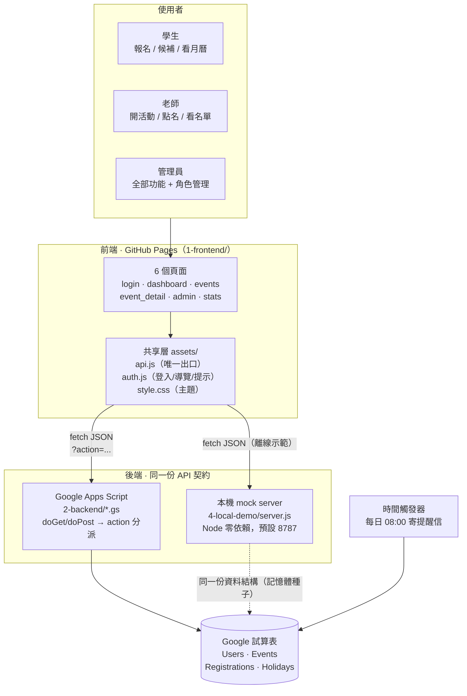
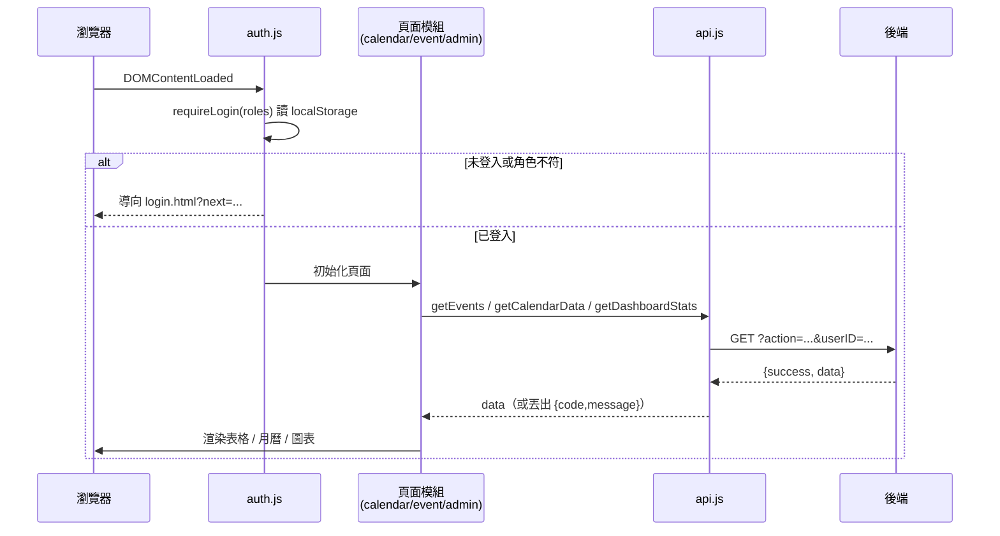
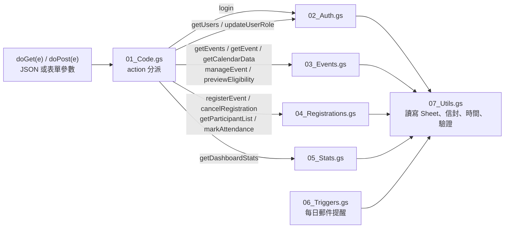
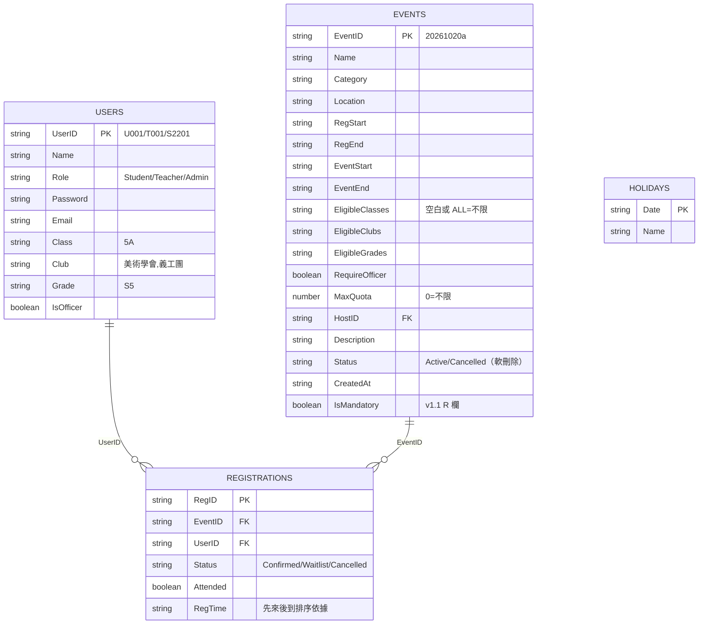
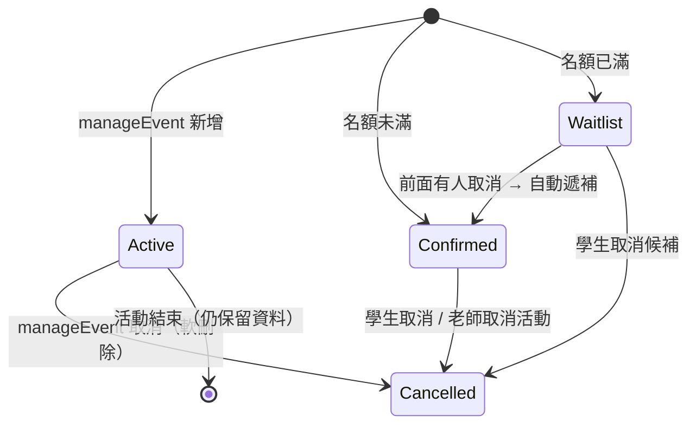
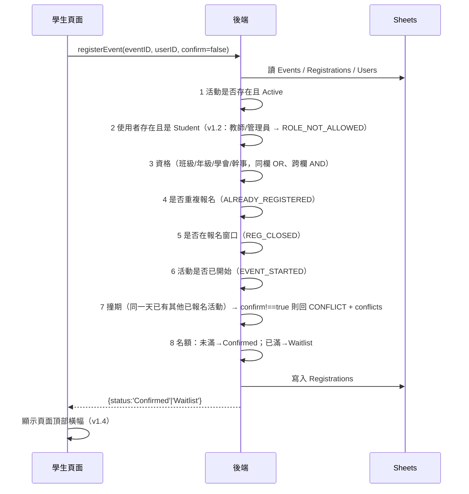
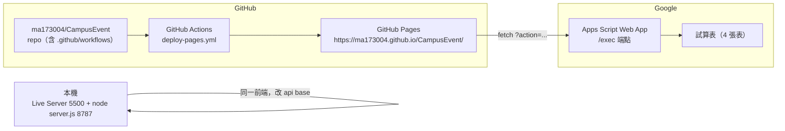

# 校園活動管理系統 · 系統架構說明

> 版本：v1.4（2026-11-07）　作者：馬君霖 · ICT SBA
> 對象：想快速看懂「這個網站是怎麼組起來的、為什麼這樣設計」的老師、評審或下一位開發者。

---

## 0. 三十秒版本

```
瀏覽器（6 個靜態頁面） --fetch(JSON)--> 後端（Google Apps Script 或本機 Node mock）
                                             |
                                             v
                                  Google 試算表（4 張工作表 = 資料庫）
```

- **前端**：純 HTML/CSS/JavaScript（Bootstrap 5 + FullCalendar 6 + Chart.js 4），沒有任何建置步驟，直接放上 GitHub Pages 就能跑。
- **後端**：Google Apps Script（GAS）的單一 Web App 進入點，用 `action` 參數分派到不同功能；同一份契約另外用零依賴的 Node 程式（`4-local-demo/server.js`）實作，讓專案在完全離線、沒有 Google 帳號的情況下也能完整示範。
- **資料庫**：Google 試算表的 4 張工作表（`Users`、`Events`、`Registrations`、`Holidays`），欄位與規則全部寫在 `3-docs/05_API契约与数据字典.md`。
- **關鍵原則**：前端只認識「一份 API 契約」，不知道後端是 GAS 還是本機 mock；所有時間、名額、資格的判斷都以**後端**為準。

---

## 1. 為什麼是這個架構（設計約束）

| 約束 | 說明 | 架構上的結果 |
|---|---|---|
| 學校沒有伺服器 | 中學生專題不可能租 VM / 開資料庫 | 用 Google Apps Script（免費、免主機）當後端 |
| 要能隨時示範 | 評審看的時候不能「連不上 Google」 | 加一個零依賴本地 mock server，同一契約、同一介面 |
| 資料要讓人看得懂 | 老師想直接看到報名名單 | 用 Google 試算表當資料庫，可直接開來看/改 |
| 前端要能公開展示 | 免費、穩定、可分享連結 | 靜態前端放 GitHub Pages，用 Actions 自動部署 |
| 三個模組要能並行開發 | 前端頁面多、後端介面多 | 先把 API 契約（`05_API契约与数据字典.md`）寫死，再分頭實作 |

代價（也是已知限制，見第 10 節）：GAS 冷啟動較慢、有每日配額、不能用 npm 套件、跨網域要繞 CORS。

---

## 2. 系統總覽



重點：**前端只有 `assets/js/api.js` 知道後端位址**。要從本機 mock 換成雲端 GAS，只需要改一個常數或設定 `localStorage.ces_api_base`，其餘程式碼完全不用動。

---

## 3. 前端架構（1-frontend/）

### 3.1 分層

| 層 | 檔案 | 職責 | 行數 |
|---|---|---|---|
| 頁面 | `login.html` / `dashboard.html` / `events.html` / `event_detail.html` / `admin.html` / `stats.html` | 只放 HTML 骨架與容器，資料都由 JS 填 | 53–298 |
| 共享層 | `assets/js/api.js` | `window.API`：組 URL、送請求、拆信封、統一錯誤碼、20 秒逾時 | 164 |
| 共享層 | `assets/js/auth.js` | `CES_AUTH`（登入狀態 localStorage `ces_user`）、`CES_UI`（導覽列、toast、**橫幅 banner**、確認框、日期格式、escapeHtml、loading） | 270 |
| 共享層 | `assets/css/style.css` | 設計 token（teal/navy）、卡片、標籤、月曆、手機版、圖層 z-index 階梯、橫幅動畫 | 594 |
| 功能模組 | `assets/js/calendar.js` | 主頁：問候、統計卡、FullCalendar 月曆（紅日/主持/已報名/必須參加）、即將舉行 | 440 |
| 功能模組 | `assets/js/event.js` | 活動列表（搜尋/篩選/排序/卡片）、詳情頁、報名/取消/撞期確認 | 714 |
| 功能模組 | `assets/js/admin.js` | 後台：活動 CRUD、資格 chips、資格人數預覽、報名名單、點名、角色管理、統計圖 | 1135 |

### 3.2 為什麼不用框架（React/Vue）

- SBA 要交的是「自己寫得出來、講得清楚」的程式，不是框架樣板；原生 JS + 單一共享層讓每一行都能解釋。
- 沒有 Node/npm／建置步驟 → GitHub Pages 直接上傳就能跑，老師用 Live Server 也能開。
- 代價：沒有雙向綁定，需手動 `document.getElementById` + `innerHTML`；因此所有插入文字一律經過 `CES_UI.escapeHtml` 防 XSS。

### 3.3 一頁的執行流程



### 3.4 狀態放哪裡

- 登入者：`localStorage['ces_user']`（只有前端信任它做 UI 顯示；權限仍由後端驗證）。
- 頁面狀態：各模組內的 module-level 變數（`listState`、`detailState`、`adminState`），刷新即重載。
- 沒有任何全域 store，避免「狀態在哪」講不清。

---

## 4. 後端架構（2-backend/）

### 4.1 單一入口 + action 分派

GAS 的 Web App 只有一個網址，所以採用「**一個端點、多個 action**」：



| 檔案 | 行數 | 職責 |
|---|---|---|
| `01_Code.gs` | 110 | `doGet`/`doPost`、CORS、JSON 解析、`action` 分派、`health` |
| `02_Auth.gs` | 111 | `login`、`getUsers`、`updateUserRole`、`requireUser_` / `requireOperator_` |
| `03_Events.gs` | 551 | 活動查詢/詳情/月曆、`manageEvent`（新增/修改/取消）、`previewEligibility`、資格判定、自動報名 |
| `04_Registrations.gs` | 278 | 報名（八步驗證）、取消、候補遞補、名單、點名 |
| `05_Stats.gs` | 195 | 儀表板統計（總量、班級、類別、出席、逐活動明細） |
| `06_Triggers.gs` | 104 | 安裝每日觸發器、寄送明日活動提醒 |
| `07_Utils.gs` | 586 | `setupDatabase()`、表頭自癒、種子資料、時間格式、錯誤信封、白名單 |

### 4.2 回應信封與錯誤

```json
{ "success": true,  "data": { ... } }
{ "success": false, "code": "NOT_ELIGIBLE", "message": "不符合資格：限 5A", "data": {} }
```

HTTP 一律 200（GAS 限制），錯誤靠 `code`。前端 `api.js` 把失敗 `reject` 成 `Error{code,message,data}`，畫面層依 `code` 決定提示文字。錯誤碼全集見契約文件 §2。

### 4.3 API 一覽（14 個 action）

| action | 方法 | 權限 | 用途 |
|---|---|---|---|
| `login` | GET | 公開 | 帳密登入，回傳使用者 + 伺服器時間 |
| `getEvents` | GET | 登入 | 活動列表（含我的狀態、是否撞期、是否已開始） |
| `getEvent` | GET | 登入 | 單一活動詳情 |
| `getCalendarData` | GET | 登入 | 月曆用：活動 + 紅日 + `now` |
| `getDashboardStats` | GET | Teacher/Admin | 儀表板統計 |
| `getParticipantList` | GET | Teacher/Admin | 某活動報名名單（正取/候補/出席） |
| `previewEligibility` | GET | Teacher/Admin | 依班級/年級/學會即時算合資格人數 |
| `getUsers` | GET | Admin | 使用者列表 |
| `registerEvent` | POST | Student | 報名（撞期需 `confirm=true`） |
| `cancelRegistration` | POST | Student | 取消（正取取消會自動遞補候補） |
| `manageEvent` | POST | Teacher/Admin | 新增/修改/取消活動（含「必須參加」自動報名） |
| `markAttendance` | POST | Teacher/Admin | 點名（活動開始後才可） |
| `updateUserRole` | POST | Admin | 改角色（不能改自己） |
| `health` | GET | 公開 | 健康檢查（版本、伺服器時間） |

> GAS 另有兩個「只給管理員在編輯器手動跑」的函式：`setupDatabase()`、`installDailyTrigger()`，不屬於 API。

---

## 5. 資料層

### 5.1 四張工作表



- **主鍵**：`UserID`、`EventID`（=`yyyymmdd`+小寫字母）、`RegID`、`Date`。
- **沒有資料庫索引**：每次查詢都是「整表讀進記憶體再過濾」。以校園規模（數百活動、數千報名）完全夠用，也讓 `03_Events.gs` 的資格判斷可以自由組合條件。
- **時間一律存文字** `YYYY-MM-DD HH:mm`：字典序 = 時間序，直接用字串比較，避免時區與 Date 物件在 GAS 序列化上的坑。

### 5.2 狀態機



---

## 6. 關鍵流程

### 6.1 報名（後端八步，順序不可換）



設計要點：
- **撞期只警告不攔截**：學生按「仍要報名」後帶 `confirm=true` 再送一次，由後端再次驗證，不信任前端。
- **名額判斷在後端**：前端顯示的剩餘名額只是參考。

### 6.2 取消 + 自動遞補

1. 學生取消 → `Status=Cancelled`。
2. 若原為 `Confirmed` 且該活動有 `Waitlist`，取 `RegTime` 最早者改為 `Confirmed`，回傳 `promoted`。
3. 前端橫幅顯示「已取消報名；候補者 陳小美 已自動遞補」。

### 6.3 點名與統計

- 點名只能對**已開始**的活動：`markAttendance` 檢查 `now < EventStart` → `EVENT_NOT_STARTED`；後台在未開始時只顯示「活動開始後可點名」，不渲染按鈕。
- 統計分成兩塊：
  - 全站總量：活動數、報名人次、確認人次。
  - **出席口徑**：只計「已開始活動」的 `Confirmed`（`totals.attendance`），避免把未來活動算成「未出席」。圓餅圖與逐活動明細都用這個口徑。

### 6.4 郵件提醒

`06_Triggers.gs` 的 `installDailyTrigger()` 建立每日 08:00 的時間觸發器；`sendDailyReminders()` 找出「明天開始」且狀態為 `Confirmed` 的報名，用 `MailApp` 寄提醒（每位收件人一封，失敗不影響其他人）。

---

## 7. 關鍵設計決策（含踩過的坑）

1. **契約先行**：先寫 `3-docs/05_API契约与数据字典.md`（request/response/錯誤碼/種子資料），再讓三條開發線（後端、前台核心頁、後台頁）並行，最後用自動化測試驗契約，避免「介面對不上」。
2. **兩個後端、同一契約**：GAS 與 `4-local-demo/server.js` 各自實作同一份 API。好處：离线可示範、可自動化測試、GAS 掛掉時還能展示。
3. **前端只有一個出口**：換後端只改 `api.js` 的 `GAS_API`（或 `localStorage.ces_api_base`），其他檔案零修改。
4. **資格規則「同欄 OR、跨欄 AND」**：勾 1A、1B 代表「1A 或 1B」，同時勾年級 S2 代表「（1A 或 1B）且 S2」。三欄都不勾 = 不限。後台 chips 下方與 `previewEligibility` 都會即時算給老師看，0 人時紅字警告。
5. **撞期只警告**：校園實務上「同一天兩個活動」很常見，硬攔截會讓學生什麼都不能報；因此改為二次確認，由學生決定。
6. **候補先來後到**：以 `RegTime` 排序，取消即遞補，不做事後手動操作。
7. **軟刪除**：活動取消只改 `Status`，統計與歷史紀錄仍可追溯。
8. **「必須參加」由後端自動報名**：`manageEvent` 勾選 `isMandatory` 後，server 對所有合資格且尚未報名的學生寫入 `Confirmed`（`autoEnrolled` 回傳人數）；學生端不能取消（`MANDATORY_EVENT`）。避免「忘了報名」造成點名對不上。
9. **時間只有一個來源：後端**。前端判斷「即將舉行 / 已開始」都用後端回傳的 `now`（`getEvents`、`getCalendarData`、`login` 都有帶），月曆初始月份也用後端 `now`（v1.4 修正），確保瀏覽器時區或測試時鐘不同時，畫面與後端判斷一致。
10. **圖層要有明確階梯（v1.4 事故）**：v1.3 為了讓浮水印/通知聽話，寫了 `.modal, .modal-backdrop, .toast-container { z-index: 1050; }`，結果 Bootstrap 的 `backdrop`（1050）與 `modal`（預設 1055）同層，而 backdrop 是後插入的兄弟節點 → **遮罩畫在彈窗上面**，彈窗整片灰、完全點不到（就是使用者回報的「新增活動界面灰屏卡住」）。修正為：導覽列 1030 < 遮罩 1050 < 彈窗 1055 < 橫幅 1045（內容層）< toast 1090。教訓：**不要一次覆寫一組元件的 z-index，要為每一層指定語意化的層級**。
11. **重要結果用橫幅、不打擾用 toast（v1.4）**：報名成功/候補/取消這種「完成後要讓使用者確認」的訊息，改成固定在導覽列下方、全寬、帶進度條與「查看我的活動」連結的橫幅；右上角 toast 只留給次要提示。橫幅插入 `#cesBannerHost`（`position:fixed`，`top` 取導覽列底部），因此捲動到頁面任何位置都看得到。

---

## 8. 部署拓撲



兩種執行模式：

| 模式 | 前端 | 後端 | 適用 |
|---|---|---|---|
| 本機示範 | `http://127.0.0.1:8787`（由 mock server 直接託管 1-frontend） | `4-local-demo/server.js`（記憶體種子） | 開發、評審現場、沒網路 |
| 雲端 | GitHub Pages | GAS Web App + Google 試算表 | 真實使用、多人同時報名 |

切換方式（三選一，優先序由高到低）：
1. `localStorage.setItem('ces_api_base', '<GAS /exec 網址>')`
2. `assets/js/api.js` 內的 `GAS_API` 常數
3. 在 localhost 或 `GAS_API` 還是佔位符時，自動退回 `LOCAL_API`

CORS 處理：GAS `ContentService` 不支援自訂 header 的預檢請求，所以 POST 一律用 `Content-Type: text/plain` 送 JSON 字串，後端自己 `JSON.parse`。

---

## 9. 權限模型

| 功能 \ 角色 | Student | Teacher | Admin |
|---|---|---|---|
| 看活動/月曆/詳情 | ✓ | ✓ | ✓ |
| 報名 / 取消報名 | ✓（mandatory 不可取消） | ✗（`ROLE_NOT_ALLOWED`，介面也不顯示按鈕） | ✗ |
| 開活動 / 改活動 / 取消活動 | ✗ | ✓（只能動自己負責的） | ✓（全部） |
| 點名 / 看報名名單 | ✗ | ✓（自己負責的） | ✓ |
| 資格人數預覽 | ✗ | ✓ | ✓ |
| 統計儀表板 | ✗ | ✓ | ✓ |
| 使用者角色管理 | ✗ | ✗ | ✓（不能改自己） |

前端只做「按鈕要不要畫出來」；**真正的檢查全部在後端**（`requireUser_`、`requireOperator_`），所以就算有人手動呼叫 API 也繞不過去。

---

## 10. 安全與已知限制

**已做的**
- 所有動態文字插入前都經 `escapeHtml`（防 XSS）。
- 後端對每個 action 驗證「使用者存在 + 角色 + 資料擁有權」，不信任前端傳來的角色。
- 資格/名額/報名窗口/撞期全部由後端重算。
- 密碼錯誤訊息統一為「帳號或密碼錯誤」，不洩漏帳號是否存在。

**限制（SBA 範圍內可接受，但要在報告說清楚）**
- 密碼以**明文**存在 `Users` 表：方便老師重設、也是課堂示範；正式上線應改雜湊 + 加鹽。
- 沒有 token/session 過期：登入狀態存在瀏覽器，關掉就沒了；API 用 `userID` 識別，理論上可被偽造（GAS 端點公開）。正式產品應簽發短期 token。
- 併發寫入沒有鎖：GAS 雖是單執行緒，但多個請求交錯時名額可能超收，建議用 `LockService` 包住報名區塊。
- GAS 配額（每日執行時間/郵件數）與冷啟動延遲；資料量大時整表讀取會變慢。
- 試算表本身是資料庫，欄位順序靠表頭自癒維持，不建議手動插入欄位。

---

## 11. 測試策略

| 層級 | 工具 | 內容 |
|---|---|---|
| 後端純邏輯 | GAS 記憶體樁（`SpreadsheetApp`/`ContentService`/`MailApp` 假物件） | 不用網路、不用真 Google 帳號即可跑完整流程 |
| API 契約 | `4-local-demo/server.js` + curl/Node | 14 個 action 的正常與錯誤路徑 |
| 端到端 | `_e2e/e2e.mjs`（headless Chrome + CDP） | **76 項**：登入/月曆/列表/報名/撞期/候補/點名/統計/權限/手機版/截圖 |
| 視覺 | `_e2e` 截圖 + `3-docs/screenshots/`（26 張） | 每次改動後人工複核 |
| 時間相關 | `CES_NOW='2026-10-18 09:00' node 4-local-demo/server.js` | 固定「現在」，讓測試不受真實日期影響 |

端到端測試會檢查：console 無錯誤、無水平溢出、Modal 圖層正確（`modalZ > backdropZ`）、報名成功出現橫幅、未開始活動不能點名、老師看不到報名按鈕、圓餅圖口徑為 2/3 等。

---

## 12. 檔案 → 職責對照表

```
CampusEventSystem/
├─ 1-frontend/                 前端（可直接靜態託管）
│  ├─ login.html               登入
│  ├─ dashboard.html           主頁：月曆 + 統計 + 即將舉行
│  ├─ events.html              活動列表：搜尋/篩選/排序/報名
│  ├─ event_detail.html        詳情 + 報名/取消
│  ├─ admin.html               後台：活動管理 / 報名與點名 / 權限管理
│  ├─ stats.html               數據報表（Chart.js）
│  └─ assets/{css,js,img}      共享層 + 功能模組 + 圖示
├─ 2-backend/                  GAS 後端（貼到 Apps Script 編輯器）
│  ├─ 01_Code.gs               入口與 action 分派
│  ├─ 02_Auth.gs               登入/權限/使用者
│  ├─ 03_Events.gs             活動 CRUD/月曆/資格預覽
│  ├─ 04_Registrations.gs      報名/取消/候補/點名
│  ├─ 05_Stats.gs              統計
│  ├─ 06_Triggers.gs           每日提醒
│  └─ 07_Utils.gs              工具 + setupDatabase()
├─ 4-local-demo/               本機 mock 後端（同一契約）
│  ├─ server.js                零依賴 Node（靜態託管 + API + 記憶體種子）
│  └─ README.md
├─ 3-docs/                     交付文件
│  ├─ 01_数据库结构说明.md
│  ├─ 02_网站结构图.png
│  ├─ 03_测试账号.txt
│  ├─ 04_运行说明.md
│  ├─ 05_API契约与数据字典.md   ← 唯一真相來源
│  ├─ 06_GitHub实战教程.md
│  ├─ 07_测试报告与验收.md
│  ├─ 08_GitHub使用教學.md
│  ├─ 09_系统架构说明.md        ← 本文件
│  └─ screenshots/             26 張操作截圖
└─ .github/workflows/          GitHub Actions（Pages 自動部署）
```

---

## 13. 如果要繼續擴充

1. **密碼雜湊 + token**：`07_Utils.gs` 加 `hashPassword_`，登入回傳短期 token，前端存在 `sessionStorage`。
2. **`LockService`**：包住 `registerEvent` / `cancelRegistration` 的名額段落，徹底避免超收。
3. **分頁與虛擬滾動**：活動量大時 `getEvents` 加 `page/size`，前端表格只渲染當前頁。
4. **通知中心**：把 `ces_banner` 擴充成可保留的訊息列表（目前是 5 秒自動消失）。
5. **匯出**：活動報名名單匯出 CSV/PDF，或把統計圖做成可下載的 PNG 給老師貼公告。
6. **PWA**：加 manifest + service worker，手機可「加到主畫面」，離線時顯示上次資料。

---

*文件維護：每次 API 契約或架構有變動，同步更新本文件與 `3-docs/05_API契约与数据字典.md`。*
