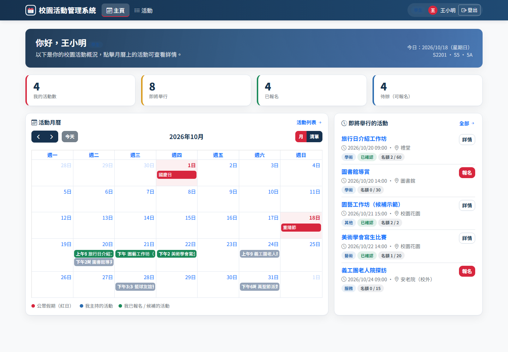
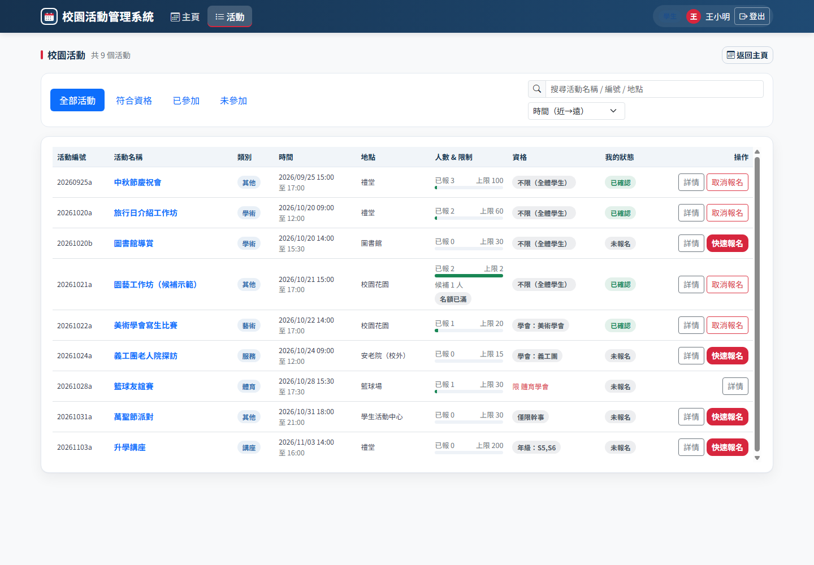
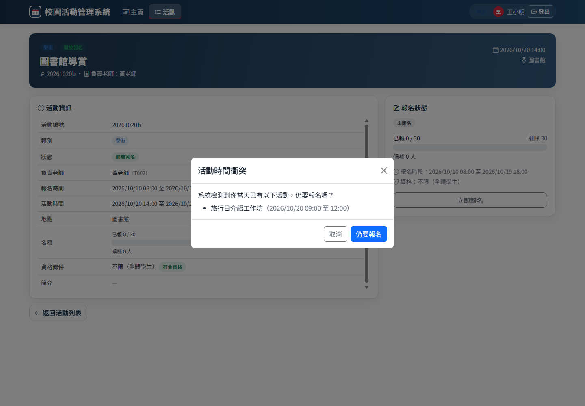
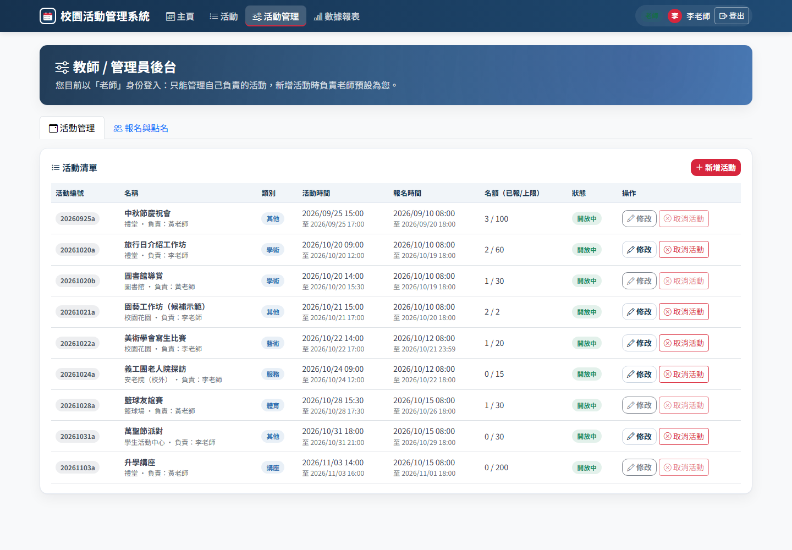
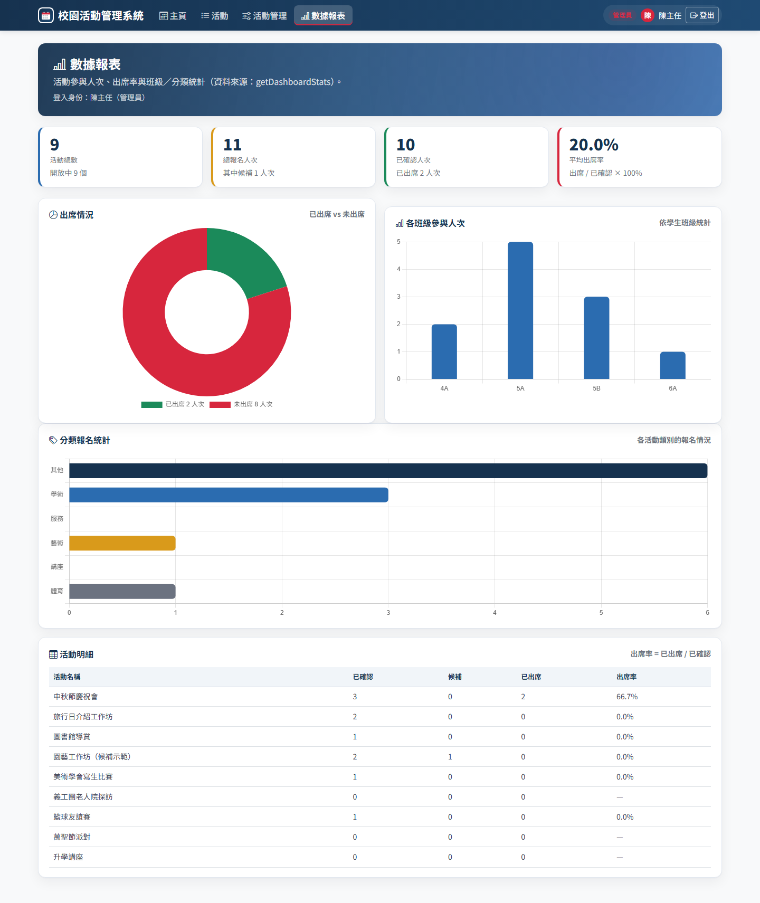

# 校園活動管理系統 · Campus Event Management System

> 香港中學 ICT SBA 專題研習 —— 以「校園活動報名與管理」為題的完整網站系統。
> 前端為純靜態網頁（Bootstrap 5 + 原生 JavaScript），後端為 Google Apps Script，資料儲存於 Google 試算表。

---

## 一、這個系統可以做甚麼？

| 角色 | 可以做甚麼 |
| --- | --- |
| **學生 Student** | 用日曆／列表瀏覽活動 → 查看詳情（時間有否撞期、名額是否已滿、自己是否符合資格）→ 報名（滿額自動進入候補）→ 取消報名 → 查看「已參加／未參加」 |
| **老師 Teacher** | 新增／修改／取消自己負責的活動 → 查看報名名單 → 標記出席 → 收到每日活動提醒電郵 |
| **管理員 Admin** | 擁有老師全部權限，另可查看數據報表、管理所有用戶的角色（Student / Teacher / Admin） |

主要功能：活動分類、活動日曆（公眾假期紅日、我主持／已報名分色）、撞期警告（只警告不攔截）、候補名單自動遞補、名額控制、資格限制（班級／年級／學會／職位）、權限控制、數據統計圖表、每日郵件提醒。

---

## 二、專案結構

```
CampusEventSystem/
├── 1-frontend/                 純靜態前端（可直接部署到 GitHub Pages）
│   ├── login.html              登入頁
│   ├── dashboard.html          主頁：日曆 + 即將舉行活動
│   ├── events.html             活動列表：搜尋 / 分類篩選 / 四個 Tab
│   ├── event_detail.html       活動詳情：報名 / 取消 / 候補
│   ├── admin.html              活動管理、報名名單與點名、用戶權限
│   ├── stats.html              數據報表（Chart.js 圖表）
│   └── assets/
│       ├── css/style.css       全站樣式（共用）
│       ├── js/api.js           與後端通訊的封裝（唯一後端入口）
│       ├── js/auth.js          登入狀態與共用 UI（導航、toast、對話框）
│       ├── js/calendar.js      日曆元件（dashboard 用）
│       ├── js/event.js         活動列表與詳情頁邏輯
│       ├── js/admin.js         後台管理邏輯
│       └── img/logo.png        Logo
├── 2-backend/                  Google Apps Script 後端（7 個 .gs 檔）
│   ├── 01_Code.gs              doGet / doPost 入口與 action 路由
│   ├── 02_Auth.gs              登入驗證與權限檢查
│   ├── 03_Events.gs            活動 CRUD、EventID 生成
│   ├── 04_Registrations.gs     報名核心邏輯、候補遞補、點名
│   ├── 05_Stats.gs             儀表板統計
│   ├── 06_Triggers.gs          每日定時觸發器（郵件提醒）
│   └── 07_Utils.gs             Sheet 讀寫、JSON 回應、日期與 ID 工具
├── 3-docs/                     文件（見下表）
├── 4-local-demo/               本機示範伺服器（不需要 Google 帳號即可先玩）
│   ├── server.js               零依賴 Node.js mock 後端 + 靜態網站伺服器
│   └── README.md               本機執行說明
└── .github/workflows/deploy-pages.yml   GitHub Actions：自動部署前端到 Pages
```

### 文件索引（3-docs）

| 檔案 | 內容 |
| --- | --- |
| `01_数据库结构说明.md` | 4 張工作表（Users / Events / Registrations / Holidays）的欄位、關係與初始化步驟 |
| `02_网站结构图.png` | 網站結構圖（頁面、共享資源、後端與資料庫的關係） |
| `03_测试账号.txt` | 測試帳號密碼 + 建議示範路線 |
| `04_运行说明.md` | 兩種啟動方式（本機示範 / 真正部署到 Google）+ 排錯 |
| `05_API契约与数据字典.md` | **開發契約**：所有 action、請求／回應格式、錯誤碼、欄位定義 |
| `06_GitHub实战教程.md` | 由零開始的 GitHub 實戰教程（推送、分支、PR、Actions、Pages…） |
| `07_测试报告与验收.md` | 自動化測試結果（26/26）、手動驗收腳本、已修問題與已知限制 |
| `screenshots/` | 11 張實際執行截圖（登入、主頁、列表、詳情、後台、統計） |

---

## 三、快速開始（最快的玩法：本機示範，零設定）

需要先安裝 [Node.js](https://nodejs.org/)（LTS 版本即可）。

```powershell
cd CampusEventSystem
node 4-local-demo\server.js
```

然後打開瀏覽器：<http://127.0.0.1:8787>

伺服器同時提供前端網頁（`1-frontend`）與 mock API，內建種子資料，所有功能（報名、候補、撞期、點名、統計）都可以立即操作。

示範帳號：

| 帳號 | 密碼 | 角色 |
| --- | --- | --- |
| `U001` | `admin123` | 管理員（陳主任） |
| `T001` | `teacher123` | 老師（李老師，美術學會／義工團） |
| `T002` | `teacher123` | 老師（黃老師，體育學會） |
| `S2201` | `student123` | 學生（王小明 5A，S5 幹事） |
| `S2202` | `student123` | 學生（李小花 5B） |
| `S2203` | `student123` | 學生（張大文 4A） |
| `S2204` | `student123` | 學生（陳小美 6A） |
| `S2205` | `student123` | 學生（林小強 4B） |

> 想看「撞期警告」：用 S2201 登入 → 報名「20261020b」（S2201 已報了同日 20261020a）。
> 想看「候補」：用 S2205 報名「20261021a」（該活動只有 2 個正式名額，會被放入候補）。

---

## 四、部署到真正的 Google（雲端）

1. 依 `3-docs/01_数据库结构说明.md` 建立一份 Google 試算表（4 張工作表）。
2. 在試算表「擴充功能 → Apps Script」貼上 `2-backend` 的 7 個 `.gs` 檔。
3. 執行 `setupDatabase` 初始化資料 → 部署為網頁應用程式（存取權限：任何人）。
4. 把部署得到的 `/exec` 網址填入 `1-frontend/assets/js/api.js` 的 `GAS_API` 常數。
5. 前端可放到 GitHub Pages（本專案已附 Actions 工作流程）。

詳細圖文步驟見 `3-docs/04_运行说明.md`。

---

## 五、技術棧

- **前端**：HTML5 / CSS3 / 原生 JavaScript（ES6）、Bootstrap 5、FullCalendar 6、Chart.js 4
- **後端**：Google Apps Script（doGet / doPost + JSON API）
- **資料庫**：Google 試算表（4 張工作表，軟刪除以保留歷史）
- **版本控制與部署**：Git / GitHub、GitHub Actions、GitHub Pages

---

## 六、開發說明（給自己與組員）

- 所有前端頁面**只透過 `assets/js/api.js` 呼叫後端**，不直接寫 `fetch`。想切換「本機 mock」與「GAS 雲端」，只需改 `api.js` 裡的 `GAS_API`（或在瀏覽器 console 執行 `localStorage.setItem('ces_api_base', '...')`）。
- 所有 API 的請求／回應格式以 `3-docs/05_API契约与数据字典.md` 為準，前後端都必須遵守。
- 時間字串統一格式：`YYYY-MM-DD HH:mm`。
- 後端回應一律 HTTP 200，以 `{success:true,data}` 或 `{success:false,code,message}` 區分成功與失敗。

---

## 七、實際執行畫面

以下截圖全部由 headless Chrome 實際操作本機示範伺服器產生（完整 11 張見 `3-docs/screenshots/`）：

**學生主頁（月曆 + 統計 + 即將舉行）**



**活動列表（四個 Tab、資格與我的狀態）**



**撞期只警告、不攔截**



**老師／管理員後台**



**數據報表（Chart.js）**



> 測試結果：端到端 26/26 全部通過，詳見 `3-docs/07_测试报告与验收.md`。

---

*本專案為學校作業用途，資料為模擬資料。*
